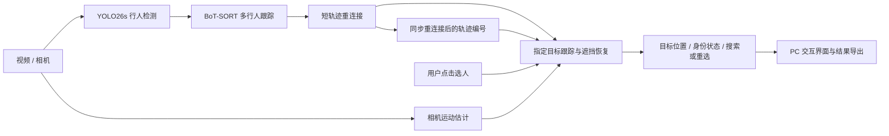

# 指定行人跟踪与遮挡恢复系统

**面向机器人人员跟随场景的 PC 端交互式视觉跟踪应用**

Selected-person Tracking and Identity Recovery after Occlusion

面向室内服务机器人人员跟随的视觉感知需求，针对人员交叉、短时遮挡及相机运动造成的目标丢失与身份混淆，实现交互选人、持续定位、遮挡搜索、身份恢复和超时重选。项目当前完成视觉算法、离线评估和 PC 应用，机器人端部署与闭环跟随控制属于后续工作。

技术栈：Python · OpenCV · YOLO26s · BoT-SORT · ONNX Runtime · NumPy · Tkinter · TrackEval。


上图来自整理后代码的真实模型运行，仅展示跟踪画面；遮挡恢复效果由下方事件评估和消融支撑。

## 视觉算法工作

- 检测与跟踪器选型：比较 YOLO11n、YOLO26n，再验证升级 YOLO26s 的效果；检查相机运动补偿和内置外观匹配的精度与耗时。
- 密集人群检测微调：使用 CrowdHuman，保留预训练行人分类参数，对忽略标注区域屏蔽负样本分类损失，并验证检测改进能否改善后续跟踪。
- 短轨迹重连接：结合外观与几何约束，将符合条件的新轨迹接回此前丢失的轨迹，减少编号断裂，并同步用户选定的目标身份。
- 指定目标身份恢复：结合外观相似度、运动一致性和多帧确认，在遮挡后判断哪个候选仍是用户选定的人；利用初始外观、逐步更新的外观和可信模板库适应姿态变化，证据不足时拒绝输出。
- 可复现评估：分别评价所有行人的轨迹质量、指定目标的正确跟踪与误跟、遮挡后的稳定恢复；统一选人起点、人工标注和事件清单，将选人失败及拒绝输出纳入评价。



## 最终测试结果

在 MOT17-11-SDP 上开展自定义指定目标测试。两种方法使用相同的微调 YOLO26s 检测权重，以及带相机运动补偿的 BoT-SORT。对照方法只跟随首次选中的轨迹编号；本项目将丢失轨迹保留 5 秒，加入短轨迹重连接，并通过外观与运动验证遮挡后的指定目标身份。

| 跟踪方法 | 正确跟踪覆盖率 | 跟错人的帧数 | 稳定找回目标的事件数 |
| --- | ---: | ---: | ---: |
| 仅锁定初始轨迹编号 | 78.98% | 30 | 10/18 |
| 加入短轨迹重连接与指定身份恢复 | **90.98%** | **30** | **17/18** |

评价包含 31 个指定目标、5,153 个目标评价帧，按每个被选中的行人分别计数。正确跟踪覆盖率表示：选人后，目标标注可见度不低于 0.3 的帧中，正确跟踪指定行人的比例。两组均按同一清单中的 18 个可评分恢复事件比较，目标重现后持续稳定跟对才算成功，包含遮挡与低可见度恢复场景。

这组比较同时包含丢失轨迹保留时间、轨迹重连接和指定身份恢复的变化。各部件的作用通过单独对照检查，见[恢复策略与消融实验](docs/EXPERIMENTS.md)；具体评价规则见[指标定义](docs/EVALUATION.md)。MOT17-11 来自官方训练集，上述结论限于本项目的自定义测试序列。

## 运行与复现

### 安装

环境：Python 3.12、NVIDIA GPU，以及支持 CUDA 13.0 的驱动。在仓库根目录直接使用当前 Python 执行：

```powershell
python -m pip install "torch==2.14.0+cu130" "torchvision==0.29.0+cu130" --index-url https://download.pytorch.org/whl/cu130
python -m pip install -e ".[runtime,evaluation,dev]"
```

第二条命令自动安装 Ultralytics、OpenCV、NumPy、ONNX Runtime、ONNX、PyYAML、Pillow、lap、TrackEval，以及 pytest／ruff 检查工具，版本约束见 [pyproject.toml](pyproject.toml)。GUI 还需要 Python 的 Tkinter，Windows 安装 Python 时包含 Tcl/Tk 组件。

### 运行

从已有权重目录校验复制模型，启动界面后选择视频并点击行人：

```powershell
python tools/prepare_models.py --source-dir "D:\tracking-models"
python tools/run_tracking_gui.py
```

也可通过命令行运行交互演示：

```powershell
python tools/run_video_joint.py --source "D:\videos\demo.mp4" --output outputs/demo --device 0 --display
```

示例路径替换为自己的文件目录。模型目录需包含 `best.pt`、`yolo26s.pt` 和 `yolo26n-reid.onnx`；微调权重暂未发布下载，模型和数据不包含在源码包中。

### 复现

准备配套标注与回放输入后，运行测试集评估：

```powershell
python tools/replay_benchmark.py --split test --output outputs/reproduce_test
```

CUDA 配置与检查、预训练演示、数据准备、训练及其他集合的复现命令见[评价与复现文档](docs/EVALUATION.md)。所有运行命令使用新的输出目录。

## 仓库导航

| 内容 | 位置 |
| --- | --- |
| 算法设计、目标身份恢复与参数 | [方法说明](docs/METHODS.md)、[身份恢复源码](src/a1_tracker/target/a2/)、[正式参数](configs/finetuned/) |
| 选型、微调、消融与关键取舍 | [EXPERIMENTS.md](docs/EXPERIMENTS.md) |
| 指标定义、协议与复现工作流 | [EVALUATION.md](docs/EVALUATION.md)、`protocols/` |
| 当前结果与验证记录 | `results/`、`provenance/` |
| 可选的未采用尝试 | `research/`，不参与正式运行 |

自有源码采用 [AGPL-3.0](LICENSE)。基础算法与数据来源见[第三方说明](THIRD_PARTY_NOTICES.md)。
