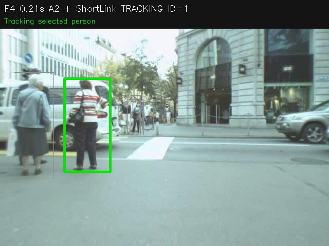
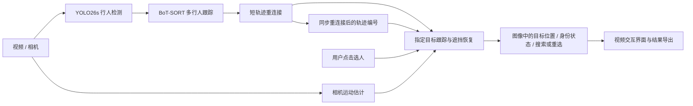

# 指定行人跟踪与遮挡恢复系统

**面向机器人人员跟随场景的交互式视觉跟踪系统**

Selected-person Tracking and Identity Recovery after Occlusion

以机器人人员跟随为应用背景，实现指定行人的交互选择、二维视觉跟踪与遮挡后身份恢复，重点解决人员交叉、遮挡和相机运动造成的目标丢失与误跟。用户可以通过视频交互界面选择目标、查看跟踪状态，并导出标注视频与跟踪结果。

技术栈：Python · OpenCV · YOLO26s · BoT-SORT · ONNX Runtime · NumPy · Tkinter · TrackEval。



上图为系统运行画面。指定目标跟踪和遮挡恢复的评估结果见下文。

## 视觉算法工作

- 检测与跟踪器选型：比较 YOLO11n、YOLO26n，再验证升级 YOLO26s 的效果；检查相机运动补偿和内置外观匹配的精度与耗时。
- 密集人群检测微调：使用 CrowdHuman，保留预训练行人分类参数，对忽略标注区域屏蔽负样本分类损失，并验证检测改进能否改善后续跟踪。
- 短轨迹重连接：结合外观与几何约束，将符合条件的新轨迹接回此前丢失的轨迹，减少编号断裂，并同步用户选定的目标身份。
- 指定目标身份恢复：结合外观相似度、运动一致性和多帧确认，在遮挡后判断哪个候选仍是用户选定的人；利用初始外观、逐步更新的外观和可信模板库适应姿态变化，证据不足时拒绝输出。
- 可复现评估：分别评价所有行人的轨迹质量、指定目标的正确跟踪与误跟、遮挡后的稳定恢复；统一选人起点、人工标注和事件清单，将选人失败及拒绝输出纳入评价。



## 最终测试结果

基于 MOT17 官方训练集序列划分开发、验证和测试集，评估指定行人的持续跟踪与遮挡恢复能力。下表展示 MOT17-11-SDP 测试序列的结果，各组使用相同的目标清单、选人起点和微调 YOLO26s 检测权重，基础跟踪器为带相机运动补偿的 BoT-SORT。

| 跟踪与身份处理方式 | 正确跟踪覆盖率 | 跟错人的帧数 | 稳定找回目标的事件数 |
| --- | ---: | ---: | ---: |
| 基础跟踪，锁定初始轨迹编号 | 78.98% | 30 | 10/18 |
| 短轨迹重连接，指定目标身份恢复 | **90.98%** | **30** | **17/18** |

改进方案将丢失轨迹保留 5 秒，加入短轨迹重连接，并结合外观、运动约束、多帧确认和外观更新恢复指定目标身份。

评价包含 31 个指定目标、5,153 个目标评价帧和同一清单中的 18 个恢复事件。正确跟踪覆盖率按选人后标注可见度不低于 0.3 的目标人帧统计；目标重现后连续跟对至少 0.2 秒计为稳定恢复。各部件的消融见[恢复策略与消融实验](docs/EXPERIMENTS.md)，评价规则见[指标定义](docs/EVALUATION.md)。

## 运行与复现

### 安装

环境：Python 3.12、NVIDIA GPU、支持 CUDA 13.0 的驱动。命令在仓库根目录执行。

```powershell
python -m pip install "torch==2.14.0+cu130" "torchvision==0.29.0+cu130" --index-url https://download.pytorch.org/whl/cu130
python -m pip install -e ".[runtime,evaluation,dev]"
```

### 运行

准备模型后，启动界面选择视频并点击行人：

```powershell
python tools/run_tracking_gui.py
```

也可通过命令行运行交互演示：

```powershell
python tools/run_video_joint.py --source data/demo.mp4 --output outputs/demo --device 0 --display
```

模型准备、微调训练及预训练模型的运行方式见[运行说明](docs/EVALUATION.md)。

### 复现

准备配套标注与回放输入后，运行测试集评估：

```powershell
python tools/replay_benchmark.py --split test --output outputs/reproduce_test
```

数据准备、训练和各集合的评估步骤见[评价与复现](docs/EVALUATION.md)。

## 仓库导航

| 内容 | 位置 |
| --- | --- |
| 算法设计、目标身份恢复与参数 | [方法说明](docs/METHODS.md)、[身份恢复源码](src/a1_tracker/target/a2/)、[正式参数](configs/finetuned/) |
| 选型、微调、消融与关键取舍 | [EXPERIMENTS.md](docs/EXPERIMENTS.md) |
| 指标定义、协议与复现工作流 | [EVALUATION.md](docs/EVALUATION.md)、`protocols/` |
| 筛选后的 GT ID 与恢复事件表 | [评价清单](docs/EVALUATION.md#数据划分) |
| 当前结果与验证记录 | `results/`、`provenance/` |
| 可选的未采用尝试 | `research/`，不参与正式运行 |

自有源码采用 [AGPL-3.0](LICENSE)。基础算法与数据来源见[第三方说明](THIRD_PARTY_NOTICES.md)。
