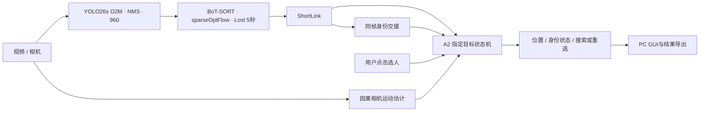

# 指定行人跟踪与遮挡恢复系统

**面向机器人人员跟随场景的 PC 端交互式视觉跟踪应用**

Selected-person Tracking and Identity Recovery after Occlusion

面向室内服务机器人人员跟随的视觉感知需求，针对人员交叉、短时遮挡及相机运动造成的目标丢失与身份混淆，实现交互选人、持续定位、遮挡搜索、身份恢复和超时重选。项目当前完成视觉算法、离线评估和 PC 应用，机器人端部署与闭环跟随控制属于后续工作。

技术栈：Python · OpenCV · YOLO26s · BoT-SORT · ONNX Runtime · NumPy · Tkinter · TrackEval。


上图来自整理后代码的真实模型运行，仅展示跟踪画面；遮挡恢复效果由下方事件评估和消融支撑。

## 视觉算法工作

- 检测与基础跟踪选型：从 11n／26n 的初期比较，到 26s 的下游验证；分别检查 GMC 和内置 ReID 的收益及代价。
- 检测微调：使用 CrowdHuman，保留 person 分类分支的预训练参数，实现双分支 ignore 区域监督，并验证检测改进能否传递到下游。
- ShortLink：在原生 BoT-SORT 关联后连接短轨迹，向指定目标策略发布同帧身份交接事件。
- 独立 A2：结合外观、运动、候选竞争、持续确认、固定锚点、EMA 和可信多模板库；身份重命名不重置或绕过恢复确认。
- 可复现评估：区分全行人 MOT 指标与指定目标身份指标，统一选择起点、GT 和事件口径；保留失败初始化及拒绝输出。



## 最终测试结果

微调后相同 YOLO26s 权重，MOT17-11-SDP 自定义指定目标测试：

| 系统 | 正确覆盖率 C | 误跟 W 帧 | 共同队列稳定恢复 |
| --- | ---: | ---: | ---: |
| T2＋A0 基础系统 | 78.98% | 30 | 10/18 |
| 完整系统 | **90.98%** | **30** | **17/18** |

31 个指定目标、5,153 个主可见人帧。MOT17-11 来自官方训练集，是本项目自定义测试序列；上述结论限于该序列。共同队列是诊断口径。正式条件恢复为 17/17，但不同方法的条件分母不同，不能混用。T2＋A0 和完整系统同时存在 Lost 保留、ShortLink、A2 等差异，这张表展示整套系统收益。

另有共享最终 Tracker 输出的 A0／A1／A2 比较：测试集 A0 为 89.93%／104 个误跟帧，朴素外观 A1 为 73.72%／1,150 帧，A2 为 90.98%／30 帧。模板库和 EMA 的贡献见[实验详情](docs/EXPERIMENTS.md)。

## 运行与复现

在仓库根目录执行（Python 3.12 已验证）：

```powershell
python -m venv .venv
.venv\Scripts\python.exe -m pip install -e ".[runtime,evaluation,dev]"
.venv\Scripts\python.exe tools/prepare_models.py --source-dir <本地权重目录>
.venv\Scripts\python.exe tools/run_tracking_gui.py
```

本地正式模型为 `models/best.pt`，ReID 为 `models/yolo26n-reid.onnx`。权重和数据不进入 Git。微调权重暂未发布下载；当前可从已有权重目录校验复制，或按训练入口重新训练。原始预训练演示可使用 `prepare_models.py --download --profile pretrained`，再显式加载 `configs/pretrained/`；该演示结果与正式微调结果不同。

无 GUI 批处理与脚本化点击：

```powershell
.venv\Scripts\python.exe tools/run_video_joint.py --source <视频路径> --output outputs/demo --device cpu --actions <点击清单.json>
```

点击清单格式：`[{"frame":3,"action":"click","x":200,"y":180},{"frame":20,"action":"reset"}]`。交互演示加 `--display`；详细安装、训练、输入准备和评估命令见[评价与复现](docs/EVALUATION.md)。

## 仓库导航

| 内容 | 位置 |
| --- | --- |
| 最终算法与参数 | [METHODS.md](docs/METHODS.md)、`src/a1_tracker/target/a2/`、`configs/finetuned/` |
| 选型、微调、消融与关键取舍 | [EXPERIMENTS.md](docs/EXPERIMENTS.md) |
| 指标定义、协议与复现工作流 | [EVALUATION.md](docs/EVALUATION.md)、`protocols/` |
| 当前结果与验证记录 | `results/`、`provenance/` |
| 可选的未采用尝试 | `research/`，不参与正式运行 |

自有源码采用 [AGPL-3.0](LICENSE)。基础算法与数据来源见[第三方说明](THIRD_PARTY_NOTICES.md)。
