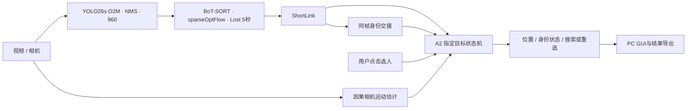

# 指定行人跟踪与遮挡恢复系统

**面向机器人人员跟随场景的 PC 端交互式视觉跟踪应用**

Selected-person Tracking and Identity Recovery after Occlusion

面向室内服务机器人人员跟随的视觉感知需求，针对人员交叉、短时遮挡及相机运动造成的目标丢失与身份混淆，实现交互选人、持续定位、遮挡搜索、身份恢复和超时重选。项目当前完成视觉算法、离线评估和 PC 应用，机器人端部署与闭环跟随控制属于后续工作。

技术栈：Python · OpenCV · YOLO26s · BoT-SORT · ONNX Runtime · NumPy · Tkinter · TrackEval。


上图来自整理后代码的真实模型运行，仅展示跟踪画面；遮挡恢复效果由下方事件评估和消融支撑。

## 视觉算法工作

- 检测与基础跟踪选型：从 11n／26n 的初期比较，到 26s 的下游验证；分别检查 GMC 和内置 ReID 的收益及代价。
- 检测微调：使用 CrowdHuman，保留 person 分类分支的预训练参数，实现双分支 ignore 区域监督，并验证检测改进能否传递到下游。
- ShortLink：在原生 BoT-SORT 关联后连接短轨迹，向指定目标策略发布同帧身份交接事件。
- 独立 A2：结合外观、运动、候选竞争、持续确认、固定锚点、EMA 和可信多模板库；身份重命名不重置或绕过恢复确认。
- 可复现评估：区分全行人 MOT 指标与指定目标身份指标，统一选择起点、GT 和事件口径；保留失败初始化及拒绝输出。



## 最终测试结果

微调后相同 YOLO26s 权重，MOT17-11-SDP 自定义指定目标测试：

| 系统 | 正确覆盖率 C | 误跟 W 帧 | 共同队列稳定恢复 |
| --- | ---: | ---: | ---: |
| T2＋A0 基础系统 | 78.98% | 30 | 10/18 |
| 完整系统 | **90.98%** | **30** | **17/18** |

31 个指定目标、5,153 个主可见人帧。MOT17-11 来自官方训练集，是本项目自定义测试序列；上述结论限于该序列。共同队列是诊断口径。正式条件恢复为 17/17，但不同方法的条件分母不同，不能混用。T2＋A0 和完整系统同时存在 Lost 保留、ShortLink、A2 等差异，这张表展示整套系统收益。

另有共享最终 Tracker 输出的 A0／A1／A2 比较：测试集 A0 为 89.93%／104 个误跟帧，朴素外观 A1 为 73.72%／1,150 帧，A2 为 90.98%／30 帧。模板库和 EMA 的贡献见[实验详情](docs/EXPERIMENTS.md)。

## 运行与复现

以下以 **Windows／PowerShell、Python 3.12、NVIDIA GPU、CUDA 13.0** 为例，直接安装到当前 Python。所有命令在仓库根目录执行。

### 1. 准备 Python 和 NVIDIA 驱动

安装 [Python 3.12（64 位）](https://www.python.org/downloads/windows/)，包含 pip 和 Tcl/Tk，并将 Python 加入 PATH。安装支持 CUDA 13.0 的 [NVIDIA 显卡驱动](https://www.nvidia.com/Download/index.aspx)，然后检查：

```powershell
python --version
python -m pip --version
nvidia-smi
```

`nvidia-smi` 应能识别显卡。顶部 `CUDA Version` 表示驱动支持的最高 CUDA 版本，实际 PyTorch 运行时版本在第 3 步检查，见 [NVIDIA 说明](https://docs.nvidia.com/datacenter/tesla/drivers/latest/cuda-toolkit-driver-and-architecture-matrix.html)。本项目使用预编译 PyTorch，CUDA 运行时随安装包提供，运行现有代码无需额外安装 CUDA Toolkit 或 cuDNN，见 [PyTorch 说明](https://discuss.pytorch.org/t/should-i-install-the-extra-cudatoolkit-and-cudnn/194528/2)。

### 2. 安装 CUDA 版 PyTorch 和项目依赖

先安装指定 CUDA 构建，再安装项目依赖。版本组合为 PyTorch 2.14.0＋torchvision 0.29.0，`cu130` 对应 CUDA 13.0；来源为 [PyTorch 官方安装源](https://download.pytorch.org/whl/cu130/)。

```powershell
python -m pip install --upgrade pip
python -m pip install "torch==2.14.0+cu130" "torchvision==0.29.0+cu130" --index-url https://download.pytorch.org/whl/cu130
python -m pip install -e ".[runtime,evaluation,dev]"
python -m pip check
```

项目依赖包含固定版本 `ultralytics==8.4.158`、`trackeval==1.3.0`，以及 OpenCV、NumPy、ONNX Runtime、Pillow、lap 和检查工具。CUDA 用于 YOLO 检测；ShortLink/A2 的外观编码保持 ONNX Runtime CPU 路径。

### 3. 检查 CUDA 是否真正可用

```powershell
python -c "import torch; print('PyTorch:', torch.__version__); print('CUDA runtime:', torch.version.cuda); assert torch.cuda.is_available(), 'CUDA unavailable: check NVIDIA driver and CUDA-enabled PyTorch'; print('GPU:', torch.cuda.get_device_name(0)); print('GPU tensor:', torch.ones(1, device='cuda').cpu())"
```

应输出 `2.14.0+cu130`、`13.0`、显卡名称和 GPU 运算后的张量。检查通过后，下面的 `--device 0` 使用第一张 NVIDIA 显卡。

### 4. 准备模型

| 文件 | 用途 |
| --- | --- |
| `models/best.pt` | 正式微调 YOLO26s 检测权重 |
| `models/yolo26s.pt` | 官方预训练参考权重及训练初始化 |
| `models/yolo26n-reid.onnx` | ShortLink/A2 外观编码 |

已有三个模型文件时，校验复制到仓库。将示例目录改成自己的权重目录：

```powershell
python tools/prepare_models.py --source-dir "D:\tracking-models"
python tools/verify_models.py
```

权重和数据不进入 Git。正式微调权重暂未发布下载，复现最终结果需要取得原 `best.pt`；也可按[训练工作流](docs/EVALUATION.md#训练工作流)训练自己的权重。只运行官方预训练参考演示时，可执行 `python tools/prepare_models.py --download --profile pretrained`，再使用[对应参考配置](docs/EVALUATION.md#从安装到演示)。

### 5. 运行指定目标跟踪

启动 GUI，选择视频、开始分析，再点击画面中的行人。CUDA 可用时 GUI 自动使用 GPU：

```powershell
python tools/run_tracking_gui.py
```

命令行交互演示：

```powershell
python tools/run_video_joint.py --source "D:\videos\demo.mp4" --output outputs/demo --device 0 --display
```

将示例视频路径改成自己的文件；输出目录须为新目录。无窗口批处理可将 `--display` 换成 `--actions actions.json`，点击清单格式为 `[{"frame":3,"action":"click","x":200,"y":180},{"frame":20,"action":"reset"}]`。

### 6. 复现指定目标评估结果

精确回放需要当前冻结协议对应的 GT、轨迹、外观特征和运动输入。已有本地复现资料时，先校验迁移，再重跑三个集合：

```powershell
python tools/prepare_reproduction.py --source-dir "D:\tracking-reproduction"
python tools/replay_benchmark.py --split development --output outputs/reproduce_development
python tools/replay_benchmark.py --split validation --output outputs/reproduce_validation
python tools/replay_benchmark.py --split test --output outputs/reproduce_test
```

默认比较 A0/A1/A2、NoBank、NoEMA，输出预测、逐帧评价、恢复事件和汇总。该回放使用固定图像派生输入，不需要 GPU 推理。源码包不含这些外部输入；只有原始 MOT 图像时，可按[评价与复现](docs/EVALUATION.md#结果复现固定输入回放)重新构建。

模型准备完成后，可运行代码与公开结果检查：

```powershell
python -m pytest
python tools/verify_results.py
python tools/check_release.py
```

## 仓库导航

| 内容 | 位置 |
| --- | --- |
| 最终算法与参数 | [METHODS.md](docs/METHODS.md)、`src/a1_tracker/target/a2/`、`configs/finetuned/` |
| 选型、微调、消融与关键取舍 | [EXPERIMENTS.md](docs/EXPERIMENTS.md) |
| 指标定义、协议与复现工作流 | [EVALUATION.md](docs/EVALUATION.md)、`protocols/` |
| 当前结果与验证记录 | `results/`、`provenance/` |
| 可选的未采用尝试 | `research/`，不参与正式运行 |

自有源码采用 [AGPL-3.0](LICENSE)。基础算法与数据来源见[第三方说明](THIRD_PARTY_NOTICES.md)。
